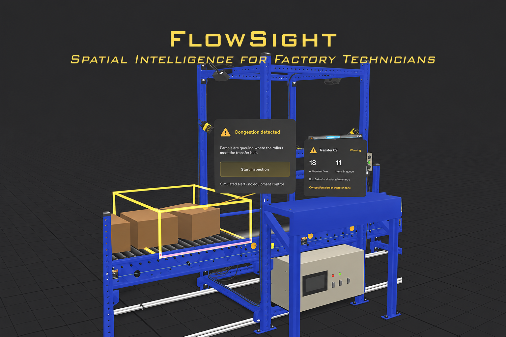

# FlowSight — Spatial Intelligence for Factory Technicians

**Spatial AR monitoring and guided inspection prototype for Snap SPECS.**



FlowSight puts a conveyor's status, alerts and inspection steps directly on the machine, at the exact spot they refer to, so a technician can keep their eyes on the line and their hands free.

> **Everything is simulated.** The telemetry, the congestion alert and the resolution in this Lens are simulated. FlowSight does not connect to sensors, does not recognise real machines, and does not operate or control any real equipment.

Built for **[Learn AR with SPECS](https://learn-specs.devpost.com/)** on Devpost. The design brief is in [`devpost/design-brief.md`](devpost/design-brief.md).

**Demo video:** [Watch FlowSight on YouTube](https://youtu.be/dFwQzenxFfQ)

---

## The problem

On a factory floor, machine data lives on dashboards that are disconnected from the machine itself. A technician reads "queue: 11" on a screen across the room, walks to the line, and then has to work out which roller, sensor or belt the number is about. Every glance away from the machine costs time and attention.

## The idea: Monitor → Detect → Inspect → Resolve

FlowSight follows one transfer station ("Transfer 02") on a parcel conveyor through four states:

| State | What the technician sees |
|---|---|
| **Monitor** (Running) | A compact status card beside the machine: belt speed 1.2 m/s, queue 3 items, flow 42 units/min. |
| **Detect** (Warning) | Parcels back up at the transfer point. An amber wireframe surrounds the congestion zone and a "Congestion detected" alert floats just above the stuck parcel, with a single **Start inspection** action. |
| **Inspect** (Inspection) | The status card shrinks to a small pill. A step card guides three checks one at a time: **Check transfer rollers**, **Check sensor alignment** and **Confirm path is clear** (1/3 → 3/3). A blue marker on the machine shows where to look for each step. |
| **Resolve** (Resolved) | The card reads "Recovering to baseline · simulated" while the metrics ramp back. It switches to "Flow restored · simulated" only once they are exactly back at 1.2 m/s, 3 items and 42 units/min. |

The Lens opens with a short walk-up: the station starts about 2 m further away and moves in, as if the technician were walking up to the machine.

## Design principles

- **Context.** Information appears on the machine it describes, not on a floating dashboard. Alerts point to the exact part with a leader line and a marker.
- **Spatial relevance.** Every element is placed where the task happens and kept clear of what matters. Cards never cover the rollers, the parcels or the machine's own built-in monitor. All UI sits on the left, inside the narrow SPECS field of view.
- **Progressive guidance.** Each state shows only what that moment needs. The full status card collapses during inspection, only the current check is emphasised, and each state has one clear primary action.

Other choices:
- Dark translucent panels with light text, because the SPECS display is additive.
- One colour per state: green for normal, amber for warning, blue for inspection.
- Labels that always face the viewer and stay readable from side angles.
- A 1-second guard between actions, so a quick double pinch can't skip a state.

## Built with

- **[Snap Lens Studio](https://ar.snap.com/lens-studio) 5.24.1**: SPECS (Spectacles) project, TypeScript components.
- **Snap SPECS**: target platform, built and tested in Lens Studio's SPECS Preview.
- **Spectacles Interaction Kit (SIK) and Spectacles UI Kit**: buttons, backplates, flex layout and billboarding.
- **[Claude Code](https://claude.com/claude-code)**: the AI coding agent that built the Lens from the design.
- **[CLAD](https://developers.specs.com/docs/clad)** (Snap's `ls-clad` agent plugin) and the **Lens Studio MCP**: scene construction, script compilation, preview capture and gesture injection.
- **[NVIDIA SimReady](https://huggingface.co/datasets/nvidia/simready-assets) `conveyor_belt_a61`**: the conveyor transfer station model (CC BY 4.0), via the [CodePawl SimReady GLB](https://huggingface.co/datasets/codepawl/simready-glb) conversion.
- **Devpost Learn skill pack** ([challengepost/learn-specs](https://github.com/challengepost/learn-specs)): its design brief template structures `devpost/design-brief.md`.

## Run it in the SPECS Preview

You don't need SPECS glasses.

1. **Install [Lens Studio](https://ar.snap.com/download) 5.24.1 or newer.** The project was saved with 5.24.1 (build 26100516), so older versions may not open it.
2. **Clone the repo with [Git LFS](https://git-lfs.com) installed.** Meshes, textures and packages are stored in LFS, as Lens Studio sets up by default, so GitHub's "Download ZIP" doesn't include them.
   ```bash
   git lfs install
   git clone https://github.com/nazelisayra/flowsight-spatial-factory-assistant.git
   ```
3. **Open `FlowSight.esproj`** in Lens Studio (File → Open Project). On first open, Lens Studio rebuilds the `Cache/` and `Support/` folders from the project and the packages in `Packages/`. This can take a minute.
4. **Check the Preview panel** is set to the **Spectacles** device. The project's target platform is already Spectacles.
5. **Watch the walk-up intro,** then try the flow with the mouse. A click acts as a pinch.
   1. **Simulate congestion** (under the status card) → Warning.
   2. **Start inspection** (on the alert card) → Inspection.
   3. **Mark as checked** three times (**Back** undoes a step), then **Complete inspection** → Resolved.
   4. **Reset demo** → back to Running.
6. **Optional:** use Interactive Preview to walk around the machine. WASD moves, Q/E go down and up, and right-drag looks around. The callout labels stay attached and readable from the sides.

## Project structure

```text
FlowSight.esproj            Lens Studio project file (target: Spectacles)
Assets/
  Scene.scene               the scene
  Scripts/
    FlowSightController.ts  state machine and simulated telemetry
    FlowSightStatusCardUI.ts  compact status card + mini pill (Monitor)
    FlowSightAlertCardUI.ts   congestion alert, leader line and marker (Detect)
    FlowSightStepCardUI.ts    one-step-at-a-time inspection card (Inspect)
    FlowSightCalloutsUI.ts    markers, leaders and labels on the machine
    FlowSightConveyorFX.ts    roller spin, parcel queue/jam, zone wireframe
    FlowSightIntro.ts         walk-up intro
    FlowSightUiKit.ts         shared type scale, colours and UI helpers
    FlowSightChecklistUI.ts   earlier checklist panel (replaced by the step card, kept disabled)
  Models/Conveyor/          NVIDIA conveyor_belt_a61, imported and optimised
  Materials/ Meshes/ Icons/ Render/
Packages/                   SIK, UI Kit and other Lens Studio packages (.lspkg)
devpost/design-brief.md     design brief for the hackathon
docs/                       README images
```

`Cache/`, `Support/`, `Workspaces/` and `PluginsUserPreferences/` are generated by Lens Studio and are not committed.

## Limitations

- **Simulated only.** No real sensors, telemetry, object recognition or equipment control. Congestion is triggered by a button.
- **Preview-tested, not device-tested.** The Lens has been built and tested in Lens Studio's SPECS Preview only. Lens Studio's developer sign-in wasn't available ("Sign-ups aren't open yet"), so it hasn't been run on real SPECS glasses. Comfort, text readability at about 2 m, pinch accuracy and frame rate are unproven.
- **Heavy model.** The conveyor is still about 168K triangles after simplification, which may be heavy for glasses.
- **No LEAF tests.** The full Running → Warning → Inspection → Resolved → Reset flow was checked in the preview with scripted pinches and screenshots. LEAF test scenarios have not been written yet.
- **One station, one user.** No history, persistence or multi-user support.

## Credits and licenses

- **FlowSight design and Lens:** Nazeli Sayra Kurtoğlu, built with Claude Code and CLAD.
- **Conveyor model:** "conveyor_belt_a61" by **NVIDIA** (SimReady Assets), licensed under [CC BY 4.0](https://creativecommons.org/licenses/by/4.0/). The GLB conversion is by **CodePawl** ([simready-glb](https://huggingface.co/datasets/codepawl/simready-glb), CC BY 4.0). The model was modified for this project (geometry simplified, physics helpers removed, textures resized).
- **Snap packages:** Spectacles Interaction Kit, Spectacles UI Kit and the other `.lspkg` packages are © Specs Inc. They are included under the [Lens Studio License Agreement](https://snap.com/en-US/terms/lens-studio-license-agreement) and [Specs Developer Terms](https://snap.com/en-US/terms/developer).
- **Icons:** Google Material Symbols (Apache 2.0), imported through Lens Studio.

Full details, including the exact list of changes to the model, are in [`THIRD_PARTY_NOTICES.md`](THIRD_PARTY_NOTICES.md) and [`ATTRIBUTION.md`](ATTRIBUTION.md).
